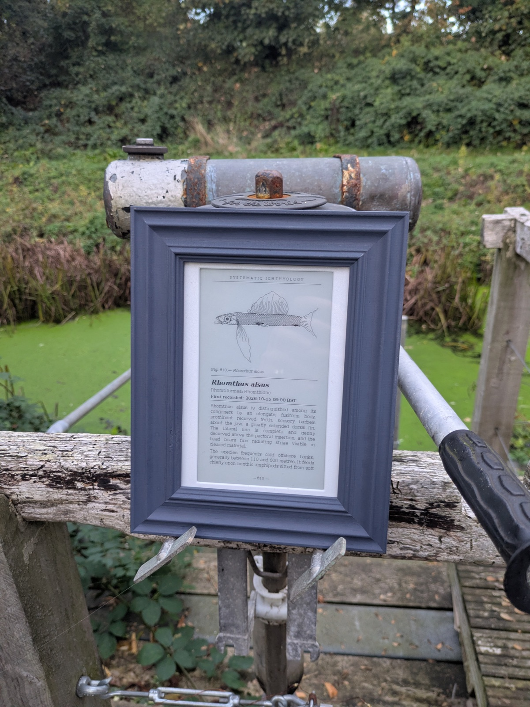
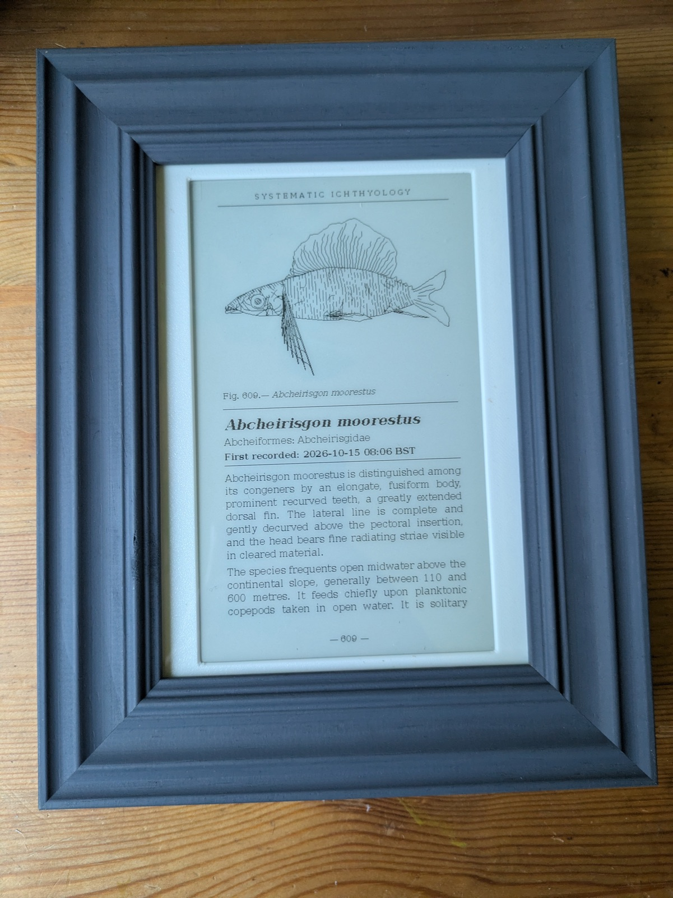
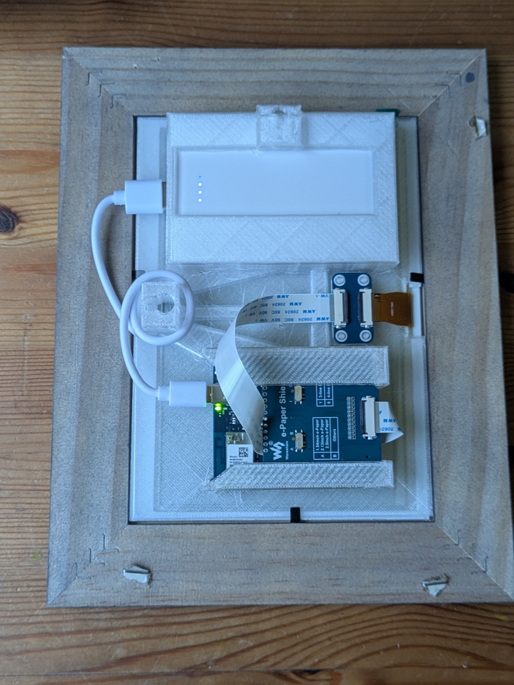
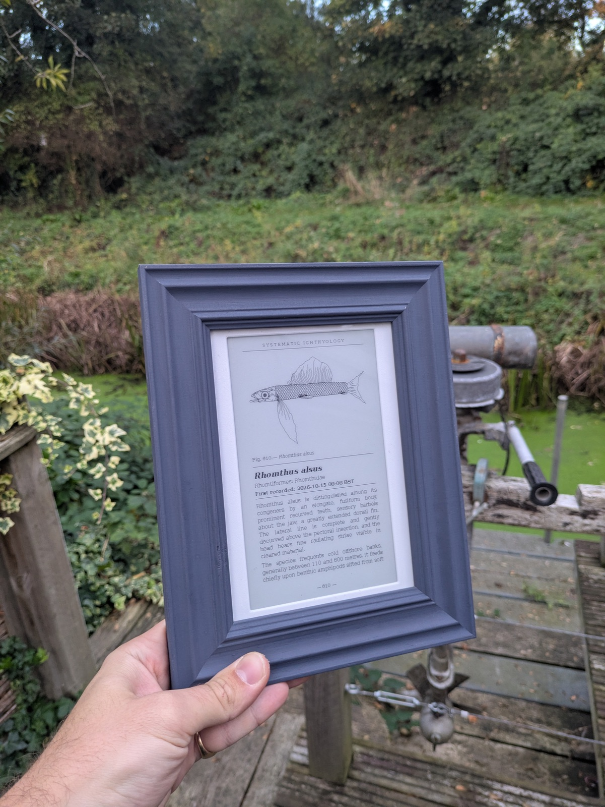
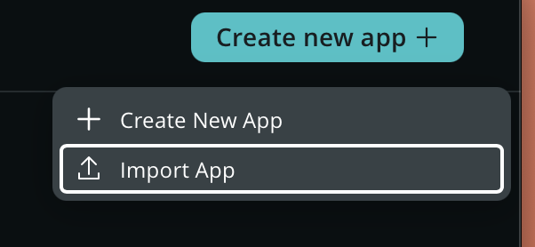
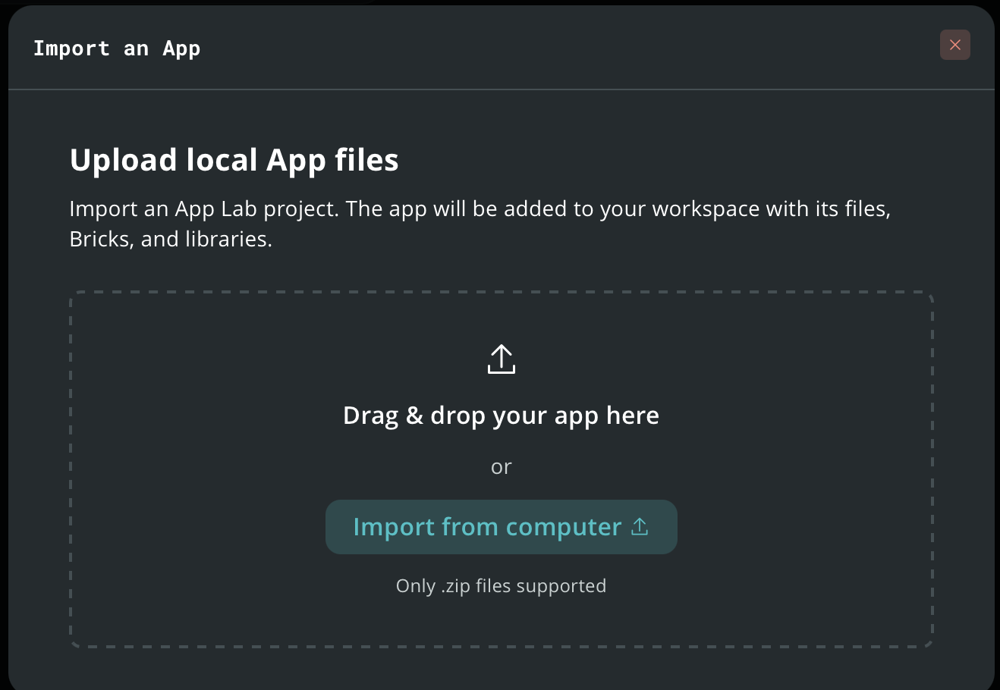
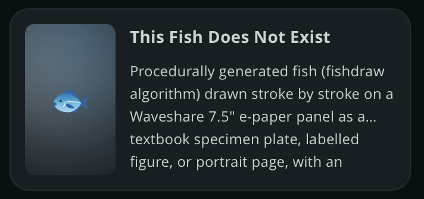
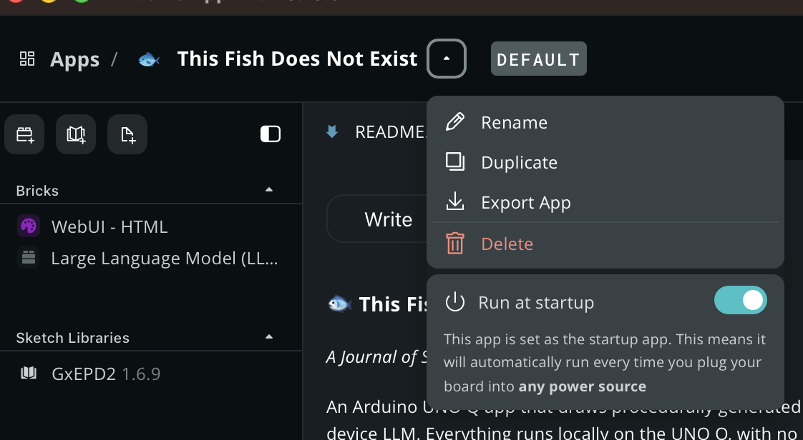

# 🐟 This Fish Does Not Exist

*A Journal of Spurious Fish.*

An Arduino UNO Q app that draws procedurally generated fish stroke by stroke on a 7.5" e-paper display, laid out as textbook pages with scientific descriptions written by an on-device LLM. Everything runs locally on the UNO Q, with no cloud services.

  
  

A new fish is generated every few minutes using the [fishdraw](https://github.com/LingDong-/fishdraw) algorithm and drawn on a Waveshare 7.5" e-paper panel (800×480) through the Arduino e-Paper Shield. The UNO Q's Linux side generates the fish, rasterizes it with PIL and streams only the changed bytes to the MCU, so fast partial refreshes reveal the drawing stroke by stroke.

## Layouts

- **plate**: landscape specimen plate with the fish's name and discovery date.
- **figure**: landscape textbook figure with a classification block.
- **page**: portrait textbook page, the layout used in the frame. A local Gemma 3 1B model (via the App Lab LLM brick) writes an invented scientific description from the fish's characteristics, and it is typed out word by word. A template fallback is used if the LLM is unavailable.

A web UI (port 7000) lets you change the layout, generation interval, draw duration, timezone and other settings.

## Hardware

The enclosure is designed around a **7×5 inch (127×178 mm) photo frame**, with the display in portrait orientation. The 3D-printed parts hold the panel, the UNO Q with its shield, and an optional slim power bank behind the frame.

  
  

### Bill of materials

| Qty | Part | Notes |
|----:|------|-------|
| 1 | Arduino UNO Q | Runs the app and the local LLM |
| 1 | Arduino e-Paper Shield | Plugs onto the UNO Q and drives the panel |
| 1 | Waveshare 7.5" e-Paper panel, 800×480 black/white | UC8179 controller, marked `075BN-T7-D2` (bare panel with flex cable) |
| 1 | FPC adapter board and ribbon cable | Connects the panel's flex cable to the shield, as shown in the rear photo |
| 1 | 7×5 inch (127×178 mm) photo frame | Any frame with a deep enough rebate for the printed plates (about 25 mm) |
| 1 | [Miady Ultra Slim 5000mAh power bank](https://www.amazon.co.uk/dp/B08T1JCXR5) (optional) | 93×61×14 mm (3.67×2.4×0.55 in). Sits in the pocket at the top of the rear plate. Includes a short USB-A to USB-C cable: USB-A into the power bank, USB-C into the UNO Q. Sold as a 2-pack, so you get a spare. Skip it if you'd rather power the UNO Q from any USB-C power source |
| ~81 g | PETG filament | About 13 g for the front plate and 68 g for the rear plate |

### Wiring

The e-Paper Shield handles the connections. Shield switches: SPI Config on D13/D12/D11, resistor on 0.47R/B. If wiring the panel directly instead:

| Panel | UNO Q |
|-------|-------|
| BUSY | D7 |
| RST | D8 |
| DC | D9 |
| CS | D10 |
| DIN (MOSI) | D11 |
| CLK (SCK) | D13 |
| VCC / PWR | 3.3V |
| GND | GND |

### 3D printed parts

Files are in [3d-print/](3d-print/):

| File | Part | Size |
|------|------|------|
| [front-plate-0.15mm.3mf](3d-print/front-plate-0.15mm.3mf) | Front plate that holds the panel | 127×178 mm, 3.2 mm thick |
| [rear-plate-0.25mm-supports.3mf](3d-print/rear-plate-0.25mm-supports.3mf) | Rear plate with the power bank pocket and UNO Q brackets | 127×178 mm, 21.6 mm tall |
| [mounting-parts.stl](3d-print/mounting-parts.stl) | Front and rear plate together in one model, for slicing in your own settings | |

The two 3MF files are the same parts sliced separately and carry the slicer settings. Both plates were printed in PETG on a Prusa CORE One (0.4 mm nozzle) using PrusaSlicer:

| | Front plate | Rear plate |
|---|---|---|
| Profile | 0.15mm BALANCED (modified) | 0.25mm SPEED (modified) |
| Filament | Generic PETG | Generic PETG |
| Supports | None | Everywhere |
| Infill | 5% | 5% |
| Brim | No | No |
| Print time | about 32 min | about 1 h 45 min |
| Filament used | about 13 g | about 68 g |

Slicer screenshots: [front plate](3d-print/print-settings/front-plate.png), [rear plate](3d-print/print-settings/rear-plate.png).

### Assembly

1. Print the front and rear plates (use the two 3MF files, or slice `mounting-parts.stl` yourself).
2. Fit the e-paper panel into the front plate and place it in the frame, so the panel shows through the frame opening.
3. Connect the panel's flex cable to the FPC adapter, then run the ribbon cable to the e-Paper Shield on the UNO Q.
4. Seat the UNO Q in the brackets at the bottom of the rear plate and the power bank (if using one) in the pocket at the top. Plug the power bank's USB-A cable end into the power bank and the USB-C end into the UNO Q, or power the UNO Q from any USB-C source.
5. Fit the rear plate into the frame and close it up with the frame's own retaining tabs.

## Running the app

1. On this GitHub page, click **Code → Download ZIP** to download the repo as a `.zip` file.
2. In Arduino App Lab, click **Create new app → Import App**.

   

3. Drag the `.zip` file into the import window (or click **Import from computer**). The app is added to your workspace with its files, Bricks and libraries.

   

   Once imported, the app appears in your list:

   

4. Open the app, click the arrow next to its name and switch on **Run at startup**, so it runs every time the UNO Q is powered.

   

5. Run the app. Open the web UI on port 7000 to pick the layout (`page` for the portrait frame) and the generation interval.

The app saves its settings and fish count to `.fishclock_state.json` on the device, so it picks up where it left off after a restart.

## Project layout

| Path | Contents |
|------|----------|
| `python/` | Fish generation (`fishdraw.py`), layouts (`layout.py`), LLM descriptions (`description.py`), main app (`main.py`) |
| `sketch/` | MCU sketch that holds the framebuffer and drives the e-paper refreshes |
| `assets/` | Web UI |
| `3d-print/` | Printable parts and slicer settings |
| `images/` | Photos of the build |

## License

Mozilla Public License 2.0, see [LICENSE](LICENSE).

## Credits

Fish generation is ported from [fishdraw](https://github.com/LingDong-/fishdraw) by LingDong-.
